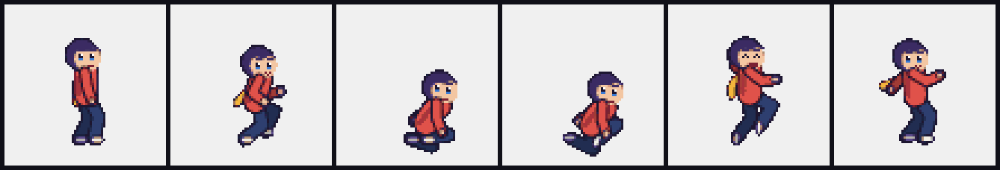
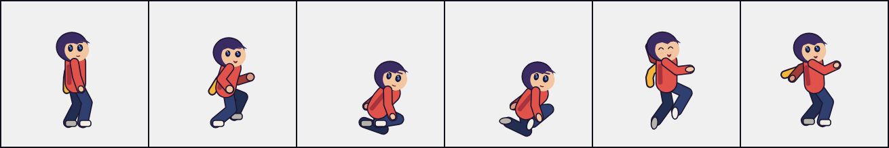

# Visual diagnostic smoke evidence

Agent: Codex (gpt-6.1-sol)

Captured from the unchanged public starter on 2026-11-09, seed 1, using the
CPU-only headless harness. [Provenance](provenance.json) pins the source commit;
[versions](versions.json) records Node and Chrome for Testing. This is **one
rig/animation family**, with two rendering modes. It is not a human-rated
calibration set, an independent judge report or a blind baseline comparison.

The complete [pixel report](pixel/report.md), [raw measurements](pixel/report.json)
and [frame manifest](pixel/frames.json) are archived with their evidence images.
The smooth sample keeps [native key poses](smooth-keyposes.png) and extracted
[metrics](smooth-metrics.json); regenerate its other sheets with the command
below. Committed PNGs are each below 48 KiB; test fixtures generate their images
rather than storing binary fixtures.

Archive image digests are in [SHA256SUMS](SHA256SUMS). Name-keyed checksum fields
are omitted from the archived JSON; numeric metrics and image bytes are
unchanged. From this directory, `sha256sum -c SHA256SUMS` verifies all 12 PNGs.

Pixel native key poses, then exact nearest 3x:




Smooth key poses at native buffer scale:



## Observed signals

| Signal | Pixel | Smooth | Observation |
| --- | --- | --- | --- |
| silhouette | warn: 53/285 frames | warn: 36/285 frames | All pixels remain connected and unclipped; some lower-body spans close into a single mass. |
| spacing | warn: p95 0.51423, max 0.58325 | pass: p95 0.09079, max 0.15126 | Hip-height-normalized endpoint acceleration; pixel front lower arm drives the warning. |
| anticipation | pass | pass | Six crouch ticks, observed launch at jump tick 6, grounded landing at 42; 36 airborne ticks. |
| overshoot | warn: 1.41389° | warn: 1.42814° | Both settle; opposite-side torso excursion is below the initial 2° proxy. |
| holds | pass: max 1 tick | pass: max 1 tick | Full-body rasters keep changing; this does not establish upper-body exposure timing. |
| jitter | pass: worst reversal fraction 0.08696 | pass: 0.04348 | No persistent alternating-step failure at the configured limit. |
| pixel grid | pass | not applicable | Pixel character alpha is binary and declared scales are integers. |

These are **3 pixel / 2 smooth advisory warnings**, not art scores. No limits
were tuned to make this starter pass. Per-tick spacing is sensitive to the
pixel starter's held upper-body timing; the two modes use different default
exposure timing. A style-aware human calibration is needed before deciding
which warnings should become a required floor.

## Author visual observations

Opened native and nearest 3x key poses, black silhouettes, pixel spacing
triplets and the smooth silhouette warning strip. These are author observations,
not independent human ratings:

- At 1x the red shirt, dark trousers, hair and small face remain readable. In the
  black idle mask the legs merge; the crouch and take-off masks are
  compact. Run/apex keys show more separated limb shapes. Closed gaps need a
  pose-specific review rather than an automatic artistic failure.
- The pixel warning triplets at run ticks 18–20 and 37–39 show stepped arm/hand
  placement. Smooth mode has a lower measured acceleration. The report exposes
  that difference; it does not establish which exposure style is preferable.
- The stop settles with a restrained counter-lean. Its measured overshoot is
  smaller than 2°, so the warning calls attention to follow-through. It cannot
  decide whether this restrained stop suits the character.
- The take-off key shows a deep tucked crouch; the apex opens up and straightens.
  The separate take-off measurement peaks at 28° and unwinds during the first
  eight airborne ticks. Independent clean/cluttered reference judgments are
  still needed to calibrate that angle limit.

## Reproduce

From the repository root, select plain Chrome/Chromium with exact canvas
readback and use fresh output directories:

```bash
export CHROME_PATH=/path/to/chromium
heavy-run node skills/toon2d-runtime-animation/scripts/visual-review.mjs \
  skills/toon2d-runtime-animation/templates/starter --query mode=pixel --out shots/review-pixel
heavy-run node skills/toon2d-runtime-animation/scripts/visual-review.mjs \
  skills/toon2d-runtime-animation/templates/starter --query mode=smooth --out shots/review-smooth
heavy-run node --test --test-concurrency=1 'tests/**/*.test.mjs'
```

Validation on the pinned source: **155/155 tests passed**, including exact
repeat-capture equality, native/enlarged pixels, smooth capture, adverse
fixtures and existing regressions. Both CLI captures exit 0 with warnings.
The actual Brave negative check exits 2 on altered RGBA readback and creates
no evidence directory. No assertion was modified. A compatible browser must
return exact canvas bytes for deterministic animation evidence.

[Pixel](takeoff-pixel.json) and [smooth](takeoff-smooth.json) raw take-off results
come from the unchanged `takeoff()` routine, including standing and running
jumps (8/8 advisory checks pass in each mode). Its standing baseline is sampled
after 30 ticks, while the visual diagnostic uses median idle height in a
longer scenario, so crouch-depth fractions differ slightly. See the
[calibration handoff](../../../skills/toon2d-runtime-animation/reference/takeoff-calibration.md).
Required grader checks and take-off status are unchanged.

Code-drawn samples retain the repository's CC BY 4.0 art license. No image
service or model call was used to create them.
