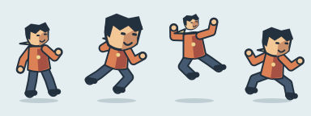
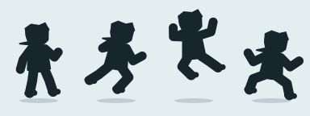
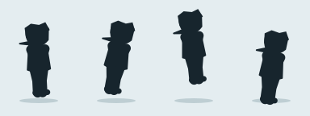
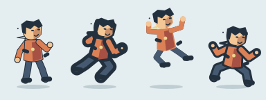
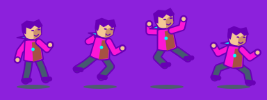
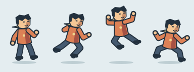
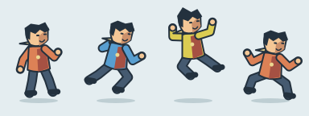
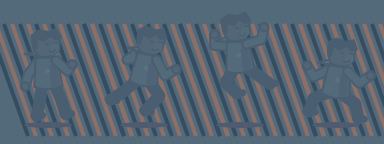
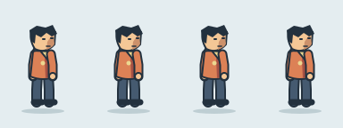

# Taste teaching sheets

These original code-drawn sheets illustrate the eight axes in the
[taste rubric](../taste-rubric.md). The fictional scarf-wearing runner uses a
simple cel style, with four drawn poses in order: idle, run, airborne and land.
Each sheet is 384 by 144 logical pixels, with one 96-pixel-wide cell per pose.
Open a sheet at its intrinsic size first, then zoom to inspect the outlines.
SVG enlargement preserves vector edges; these are not pixel-art examples.

The clear column shows the intended treatment; the adverse column deliberately
damages that treatment. They are teaching illustrations, **not human-rated
anchors, a calibration dataset, hidden grader references or scored examples**.
No rating or passing threshold is implied. Some defects affect several axes.
These four drawn keys do not demonstrate interpolation, foot locking or runtime
motion quality; use actual captures when reviewing a playable character.

| Axis | Clear treatment | Deliberate defect |
|---|---|---|
| Proportions |  |  |
| Silhouette |  |  |
| Line weight |  |  |
| Palette |  |  |
| Shading |  |  |
| On-model |  |  |
| Game scale |  |  |
| Appeal |  |  |

For example, compare the black fills before judging costume detail. The clear
airborne pose has space between its raised arms and torso; the adverse one
collapses those spaces. For shading, compare the face and coat in the second
and fourth cells, rather than treating extra shadow detail as an improvement.
For appeal, the adverse sheet's repeated pose cannot communicate the four
actions; a human still decides whether the intended alternative is appealing.

All pictures are original SVG geometry generated by
[`scripts/taste-examples.mjs`](../../scripts/taste-examples.mjs). No external
images, fonts, image-generation services or real-person references are used.
Art license: CC BY 4.0; credit the toon2d contributors. The generator is covered
by the repository's Apache-2.0 code license.

Regenerate from the repository root, without installing dependencies:

```bash
node skills/toon2d-runtime-animation/scripts/taste-examples.mjs
```

An optional output directory is useful for checking reproducibility without
overwriting the shipped sheets:

```bash
node skills/toon2d-runtime-animation/scripts/taste-examples.mjs "$TMPDIR/taste-examples"
```

Keep public teaching material separate from the evaluator's hidden reference
set. Human calibration, clean and cluttered runtime captures, held-out ratings
and the blind baseline comparison are still required by issue #5. Do not reuse
these intentional defects as independent calibration observations.
